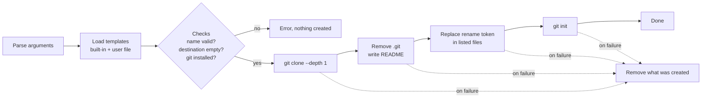

# dalang

[](https://github.com/royyandzakiy/dalang/actions/workflows/build-and-test.yml)
[](https://github.com/royyandzakiy/dalang/actions/workflows/build-and-test.yml)
[](https://github.com/royyandzakiy/dalang/releases/latest)

[](LICENSE)

Start a new project from a git template in one command. dalang clones the template, drops its
history and README, renames it to your project and starts a fresh git repository.

A *dalang* is the puppeteer of Sundanese and Javanese wayang, who brings the puppets to life.

```text
> dalang new my_app
Cloning 'min' template from https://github.com/royyandzakiy/cpp-project-template-min
Removing template history and README
Renaming 'cpp_project_template' to 'my_app'
Initializing git repository

Created 'my_app' in my_app

Next:
  cd my_app
```

## Install

Download the archive for your OS from the [latest release](https://github.com/royyandzakiy/dalang/releases/latest),
extract it and put `dalang` (`dalang.exe` on Windows) on your `PATH`. The only runtime
requirement is `git` on the `PATH`.

| OS | Archive |
|---|---|
| Windows x64 | `dalang-windows-x64.zip` |
| Linux x64 | `dalang-linux-x64.tar.gz` |
| macOS (Apple silicon) | `dalang-macos-arm64.tar.gz` |

Or [build it from source](#build-from-source).

## Usage

```text
dalang new <destination> [-t <template>] [-n <name>] [-r <ref>] [--no-git-init]
dalang new -i
dalang list
```

| Option | Meaning |
|---|---|
| `-t, --template` | Template name, default `min`. See `dalang list`. |
| `-n, --name` | Project name, default the destination folder name. A letter, then letters, digits, `_` or `-`. |
| `-r, --ref` | Template branch or tag, default the template's default branch. |
| `--no-git-init` | Leave the project without a git repository. |
| `-i, --interactive` | Pick the template, destination and name in a terminal form. |
| `-c, --config` | Read extra templates from this file instead of the user config. |
| `-v, --verbose` | Print each git command and its output. |
| `-q, --quiet` | Print errors only. |
| `-V, --version` | Print the version. |

Examples:

```bash
dalang new blinky -t zephyr
```

```bash
dalang new my_tool -t full -n mytool -r v1.0
```

The destination must not exist, or must be an empty folder. If any step fails, dalang removes
what it created.

## Templates

| Name | What you get |
|---|---|
| `min` | Minimal C++23 CMake project with presets, Conan/vcpkg and GoogleTest |
| `full` | C++23 CMake project with sanitizers, coverage, profilers and multi-OS CI |
| `qml` | Qt 6 / QML desktop app in C++23 with CMake presets and vcpkg |
| `zephyr` | Zephyr RTOS workspace with west, devcontainer, Twister and Renode |
| `idf` | ESP-IDF firmware project for ESP32 |

They are defined in [templates.toml](templates.toml), which is built into the binary.

### Your own templates

Add templates, or override a built-in one by reusing its name, in:

- Windows: `%APPDATA%\dalang\templates.toml`
- Linux and macOS: `$XDG_CONFIG_HOME/dalang/templates.toml`, or `~/.config/dalang/templates.toml`

```toml
[[template]]
name = "mylib"
url = "https://github.com/me/mylib-template"   # anything git clone accepts
description = "My library template"
# Optional: replace the template's own project name with the new one in these files.
rename = { token = "mylib_template", files = ["CMakeLists.txt"] }
```

`dalang list` shows every template and whether your file was found.

## How it works



The code lives in three files:

- [src/dalang/core.hpp](src/dalang/core.hpp): types, the process runner (reproc) and the template
  registry (toml++).
- [src/dalang/generator.hpp](src/dalang/generator.hpp): git operations and the `Generator`. Both
  are templates over any type that satisfies `ProcessRunnerConcept`, so tests swap git for a
  fake runner without an interface.
- [src/main.cpp](src/main.cpp): the command line (CLI11) and the interactive form (FTXUI).

## Build from source

Requirements: CMake 3.28+, Ninja, a C++23 compiler (Visual Studio 2022, Clang 18+, GCC 13+ or AppleClang 16+)
and Conan 2 or vcpkg. Dependencies (fmt, CLI11, FTXUI, toml++, reproc) are installed by the
package manager during configure.

```bash
git clone https://github.com/royyandzakiy/dalang.git
```

```bash
cmake --preset clang-linux-release
```

```bash
cmake --build --preset clang-linux-release
```

The binary lands in `bin/<compiler>/`. `cmake --list-presets` lists the presets for other
compilers (`msvc-release`, `clang-cl-release`, `appleclang-release`, ...). Pass
`-D PKG_MANAGER=vcpkg` to use vcpkg instead of Conan.

### Tests

```bash
cmake --preset clang-linux-debug -D BUILD_TESTING=ON
```

```bash
cmake --build --preset clang-linux-debug
```

```bash
ctest --preset test-clang-linux-debug
```

Unit tests replace git with a fake runner. A few tests run real git against a temporary local
repository and are skipped when git isn't installed.

See [EDITOR_SETUP.md](EDITOR_SETUP.md) for VS Code and CLion, and [CONTRIBUTING.md](CONTRIBUTING.md)
for making changes and releases.

## Documentation

| | |
|---|---|
| [CHANGELOG.md](CHANGELOG.md) | What changed in each version, linked to the RFCs |
| [docs/architecture](docs/architecture/README.md) | C4 context, container and component diagrams and the `new` flow, per architecture stage |
| [docs/rfc](docs/rfc/README.md) | Design write-ups: findings, alternatives, implementation, verification |
| [docs/adr](docs/adr/README.md) | One short record per architectural decision |

## License

[MIT](LICENSE)
