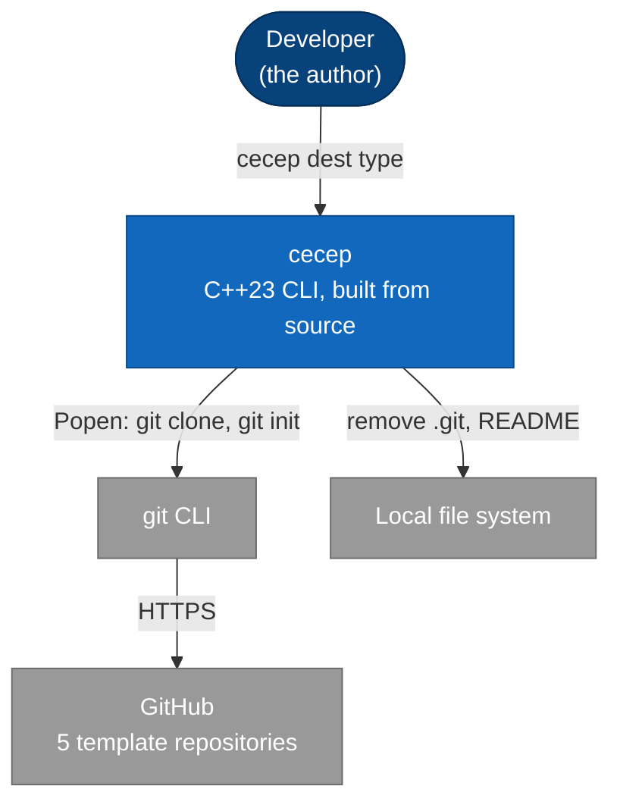
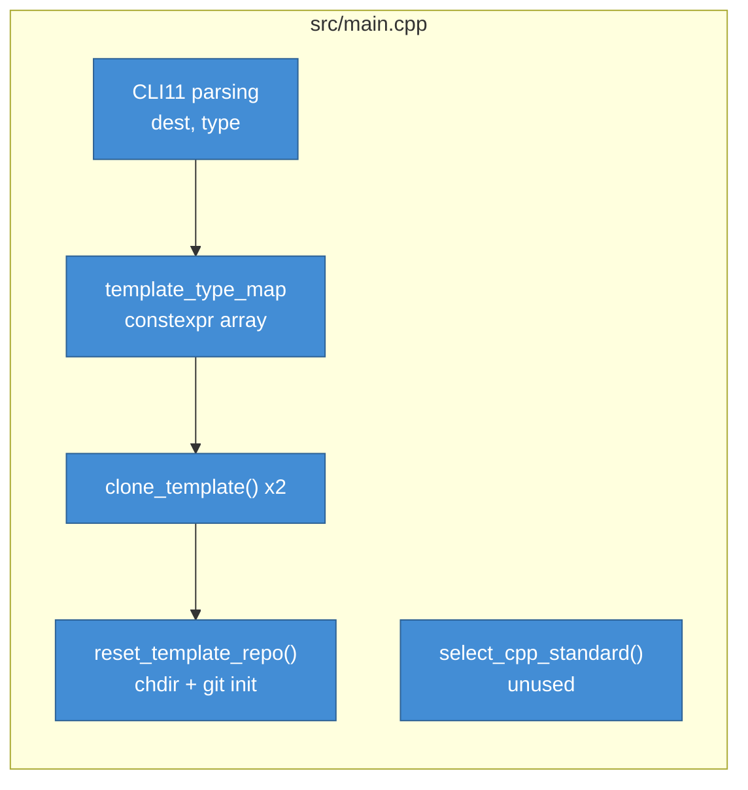
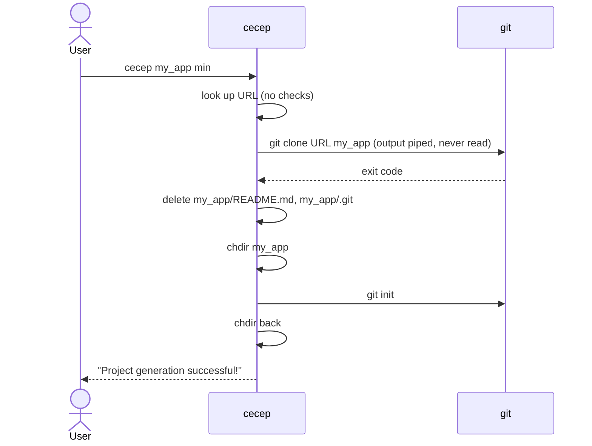

# Stage 1: cecep (v1.x)

- **Period:** 2026-06-20 – 2026-10-12
- **Code:** commit `4eb7600` (last cecep commit)
- **Shaped by:** ADR [0001](../adr/0001-git-cli-as-child-process.md); RFC
  [0001](../rfc/0001-cecep-first-generator.md)

## Summary

A personal tool built inside a copy of `cpp-project-template`: one `main.cpp` that maps a
template name to a URL, clones it with git, removes the template's `.git` and README and runs
`git init`. Built from source only; no releases.

## Context (C4 level 1)

## Containers (C4 level 2)

One executable, `cecep`, linking CLI11, fmt, cpp-subprocess, FTXUI and toml++ (the last two
unused). No configuration files, no installer.

## Components (C4 level 3)

## Key flow

## Known limits

From RFC 0001: `--help` crashed; git errors were lost; no checks before acting and no cleanup;
tests and the vcpkg build could not build; templates required a rebuild to add; generated
projects kept the template's name.
