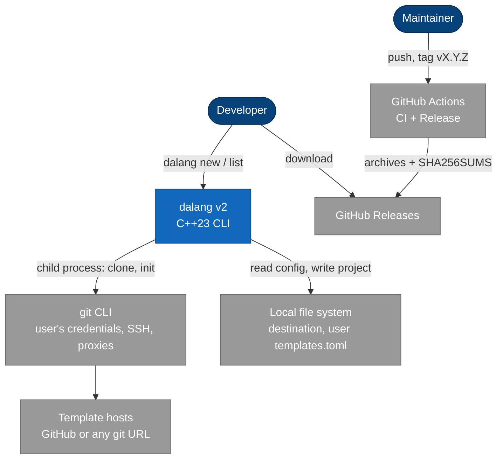
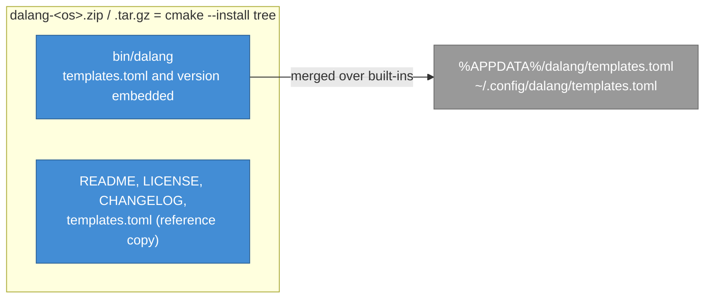
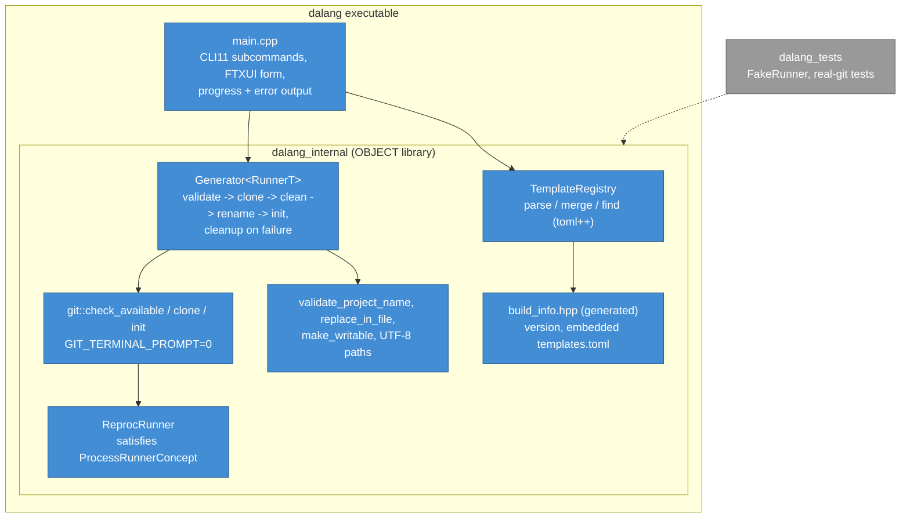
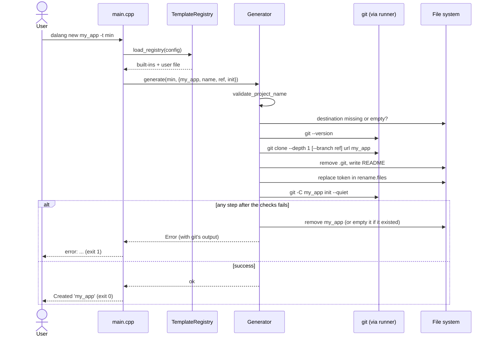

# Stage 2: Current (v2.0.0+), living document

- **Period:** 2026-10-13 – now (last updated 2026-10-13)
- **Code:** this repository, `HEAD`
- **Shaped by:** ADR [0002](../adr/0002-name-dalang.md) – [0009](../adr/0009-tag-driven-releases.md);
  RFC [0002](../rfc/0002-rename-to-dalang.md) – [0007](../rfc/0007-releases-and-docs.md)

> Update this file when the architecture changes; see [Updating](README.md#updating).

## Summary

dalang is a single executable with no files beside it. A small core (three files) loads a
template registry from TOML, validates the request, and drives the git CLI through a runner that
is a template parameter, so tests replace git without interfaces. Releases are built for three
OSes from a version tag.

## Context (C4 level 1)

## Containers (C4 level 2): what is delivered

Release builds use Conan, whose packages are static by default, so the dependencies (fmt, CLI11,
FTXUI, toml++, reproc) are inside the binary; on Windows it needs the VC++ runtime. A vcpkg build
on Windows uses DLLs (dynamic triplet).

## Components (C4 level 3)

| Component | File |
|---|---|
| Error / Result, paths, Command, runner concept, `ReprocRunner`, `TemplateRegistry`, file helpers | `src/dalang/core.hpp`, `core.cpp` |
| `git::*`, `GenerateOptions`, `Generator<RunnerT>` | `src/dalang/generator.hpp` |
| Version and embedded templates | `src/dalang/build_info.hpp.in` -> build tree |
| Command line and form | `src/main.cpp` |

## Key flow: `dalang new my_app -t min`

## What changed from stage 1

| Change | RFC / ADR |
|---|---|
| Renamed to dalang; version 2.0.0 | RFC 0002, ADR 0002 |
| Template leftovers removed; tests and vcpkg build; reproc instead of cpp-subprocess | RFC 0003, ADR 0003 |
| One file -> core library + header-only generator over `ProcessRunnerConcept`; `std::expected` | RFC 0004, ADR 0004, 0005 |
| Hardcoded table -> embedded `templates.toml` + user file; project rename | RFC 0005, ADR 0006, 0007 |
| Positional CLI -> `new` / `list`; checks before acting; cleanup on failure | RFC 0006, ADR 0008 |
| Release archives from tags; docs | RFC 0007, ADR 0009 |

## Known limits

- The `-i` form has no automated test; it needs an interactive terminal.
- Rename covers only the files a template lists.
- No offline mode: every `new` clones from the network (or a local `file://` URL).
- `fmt` instead of `std::print` until CI's standard library has `<print>` (ADR 0005).
