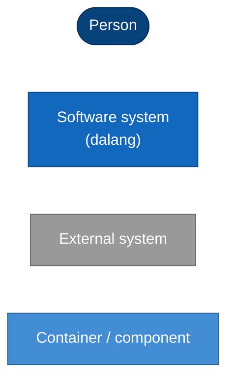

# Architecture

How dalang is built, and how that changed over time. One document per **architecture stage**: a
stage starts when the shape of the system changes (its command line, its main components, how it
is delivered), not with every RFC.

| Stage | Period | Versions | In one line |
|---|---|---|---|
| [1. cecep](01-cecep-v1.md) | 2026-06 – 2026-10 | v1.x (untagged) | One `main.cpp`: hardcoded template table, cpp-subprocess, positional CLI |
| [2. Current](02-current-v2.x.md) | 2026-10 – now | v2.0.0+ | Core library over a duck-typed runner, TOML registry, subcommand CLI, release binaries |

Stage 2 is the **living document**: update it when the architecture changes. When a change alters
the shape of the system, freeze it and add `03-<name>.md` with a "What changed from stage 2"
section and a row above.

## What each stage contains

1. **Context (C4 level 1)**: dalang, its users and the systems around it.
2. **Containers (C4 level 2)**: what is delivered and what it talks to.
3. **Components (C4 level 3)**: the main parts inside the executable.
4. **Key flow**: `dalang new`, from arguments to a fresh repository.
5. **What changed** from the previous stage, with the RFCs and ADRs, and known limits.

## Diagrams

Mermaid, so they render on GitHub and diff like code. C4 levels are drawn as flowcharts:

## Updating

- **A change that alters a diagram** (new subcommand, new component, new delivery channel): update
  stage 2's diagrams and its "What changed" list, linking the RFC/ADR.
- **A change in the shape of the system**: freeze stage 2, add stage 3.
- **Fixes and tooling** that leave the diagrams alone: RFCs and the CHANGELOG only.
