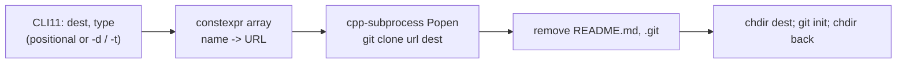

# RFC 0001: cecep, the first generator

- **Status:** Historical (describes cecep, v1.x)
- **Date:** 2026-06-20 – 2026-10-12
- **Commits:** `bf3699f` (init from cpp-project-template), `45134af` (CLI11), `142ec6b` (Popen),
  `fe6c6c1` (delete `.git`, `git init`), `591871c` (zephyr), `41caf41` (idf), `594bd84` (qml)
- **ADR:** [0001](../adr/0001-git-cli-as-child-process.md)

## Summary

cecep started as a copy of the author's `cpp-project-template` and grew a small command line
tool on top: pick a template by name, `git clone` it, delete its `.git` and README, `git init`.
It did the job for the author, but everything lived in one `main.cpp`, the build still carried
the template's demo library, and several failure paths were silent or crashed. This RFC records
how it worked and what was wrong with it, as the baseline for RFCs 0002–0007.

## Architecture

```
src/main.cpp     everything: template table, CLI parsing, git calls, file removal
                 (~170 lines, no namespace, no tests)
```



- Templates: a `constexpr std::array<std::pair<string_view, string_view>, N>` in `main.cpp`.
  Adding one meant editing the array and its size (`4eb7600` "updating array count").
- Processes: `subprocess::Popen` with stdout and stderr piped, then `wait()`.
- An FTXUI menu for choosing the C++ standard existed but its call was commented out.

## Findings

Found while reviewing the code on 2026-10-13, before the overhaul:

1. **`--help` crashed.** `app.parse()` was called without `CLI11_PARSE` or a `try`, so the
   `CallForHelp` exception CLI11 throws for `--help` (and the error for a bad argument) was
   never caught.
2. **git's errors were thrown away.** Output was piped and never read, so a failed clone printed
   only `Git clone error code: 128`. Piping both streams and only calling `wait()` can also
   deadlock once git fills a pipe buffer.
3. **Not exception safe.** `reset_template_repo` changed the process working directory with
   `fs::current_path(dest)` and only restored it on the success path.
4. **No checks before acting.** Nothing verified that git was installed or that the destination
   was empty; a half-created folder was left behind on failure.
5. **Duplicate and dead code.** `clone_template` was defined twice (`std::string` and
   `std::string_view` overloads); `select_cpp_standard()` and the FTXUI includes were unused;
   toml++ was linked but never used; a `println` passed an argument it never printed.
6. **The build was not honest.** `test/CMakeLists.txt` built `app_tests` from `src/greeter.cpp`,
   which no longer existed, and `test_math.cpp` / `test_classify.cpp` tested a `MyLib` that was
   not in the repository. CI configured with `BUILD_TESTING=ON`, so the test build could not
   succeed. `vcpkg.json` lacked `cpp-subprocess`, which has no vcpkg port, so `PKG_MANAGER=vcpkg`
   could never build.
7. **Template leftovers.** `examples/mylib_consumer`, `cmake/MyLibConfig.cmake.in`, the
   `BUILD_LIB` options and `lib-only` presets, the template's CHANGELOG and a placeholder README.
8. **The name.** "cecep" is a Sundanese given name and a pun on "cpp" that only works for readers
   who pronounce it the Sundanese way; it also no longer fit once Zephyr, ESP-IDF and QML
   templates were added.

## Outcome

Superseded by the October 2026 overhaul: rename (RFC [0002](0002-rename-to-dalang.md)), build
cleanup (RFC [0003](0003-honest-build.md)), restructure (RFC [0004](0004-core-restructure.md)),
template registry (RFC [0005](0005-template-registry.md)), CLI v2 (RFC
[0006](0006-command-line-v2.md)) and releases (RFC [0007](0007-releases-and-docs.md)). The one
decision that carried over is driving the git CLI as a child process (ADR 0001).
