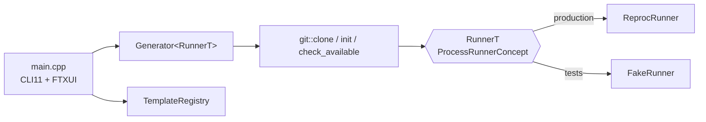

# RFC 0004: Core restructure: duck-typed runner, std::expected, three files

- **Status:** Implemented
- **Date:** 2026-10-13
- **Commits:** `a770d10` (first split), `1d4ec2b` (final shape)
- **ADR:** [0004](../adr/0004-concepts-over-interfaces.md), [0005](../adr/0005-expected-errors-and-fmt.md)
- **Related:** nexus-dll-lib-cmake ADR 0011 (templates and composition over polymorphism)

## Summary

Turn the single `main.cpp` into a small, testable core: git runs through a runner chosen at
compile time, every fallible step returns `std::expected`, and the code fits in three files.

## Findings

- Nothing in cecep could be unit tested: git calls, file edits and the CLI were in one function
  with no seam for a fake.
- A first split (`a770d10`) used an `IProcessRunner` interface and eleven files (`error.hpp`,
  `process.*`, `git.*`, `templates.*`, `generator.*`, `paths.hpp`, `interactive.*`). Review
  feedback: too many files for a tool this size, and no `I`-interfaces; use duck typing like
  nexus-dll-lib-cmake's `BleOpsImplConcept`.

## Architecture

```
src/
  dalang/core.hpp       Error / Result, UTF-8 path helpers, Command / ProcessResult,
  dalang/core.cpp       ProcessRunnerConcept, ReprocRunner, TemplateRegistry, project-file helpers
  dalang/generator.hpp  header-only: git::check_available / clone / init and
                        Generator<RunnerT = ReprocRunner>
  dalang/build_info.hpp.in  version + embedded templates.toml (generated)
  main.cpp              CLI11 command line and the FTXUI form
test/
  test_utils.hpp        TempDir, read/write helpers, FakeRunner
  test_core.cpp         registry, project files, ReprocRunner
  test_generator.cpp    git functions and Generator with FakeRunner, plus real git
```



- `ProcessRunnerConcept`: anything with `Result<ProcessResult> run(const Command &)`.
  `static_assert` checks `ReprocRunner` and `FakeRunner` against it.
- `Generator` owns its runner by value (`explicit Generator(RunnerT runner = RunnerT{}, ...)`)
  and exposes `runner()` so tests can read the recorded calls.
- `generate()` is one `and_then` chain: validate name, check destination, check git, then
  `populate()` with an `or_else` that cleans up and passes the error on.
- CMake follows nexus-dll-lib-cmake: an OBJECT library `dalang_internal` that the executable and
  the tests both link.

## Alternatives

| Option | Why not |
|---|---|
| Virtual `IProcessRunner` + gmock | Rejected in review; a vtable and a mock class for one seam |
| `std::function` runner | Works, but loses the compile-time check and the named contract |
| Exceptions for errors | Every step can fail for ordinary reasons (git missing, folder exists); `expected` keeps them in the signature |
| `std::print` / `std::format` instead of fmt | `<print>` needs libstdc++ 14; Linux CI builds against Ubuntu 24.04's GCC 13 (ADR 0005) |
| `std::ranges::to`, `vector::append_range`, `views::enumerate` | libstdc++ 14 / libc++ 19 only; replaced with plain loops and `insert` |

## Verification

- 32 tests: registry parsing and merging, project-name rules, file replacement, UTF-8 round trip,
  git argument building, every generator failure path with `FakeRunner`, and three tests that
  run real git against a temporary local repository (clone, tag checkout, unknown repository).
- clang-tidy with `WarningsAsErrors: '*'` passes on `dalang_internal` and `dalang`.
