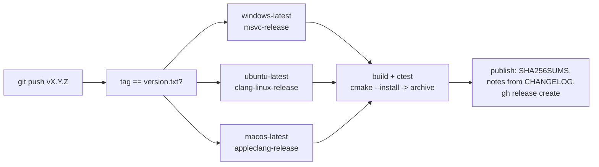

# RFC 0007: Release binaries and project documentation

- **Status:** Implemented (release workflow untested until the first `v*` tag)
- **Date:** 2026-10-13
- **Commits:** `fd0fbd7`
- **ADR:** [0009](../adr/0009-tag-driven-releases.md)

## Summary

Ship prebuilt binaries for Windows, Linux and macOS from a tag, and give the repository the
documents a reader expects: README, CHANGELOG, LICENSE, CONTRIBUTING, and this RFC / ADR /
architecture set.

## Findings

- No tags, no releases, no LICENSE; `version.txt` said 1.1.0 but nothing was ever published.
- The README was mostly placeholder headings; the CHANGELOG was the template's history.
- Design reasoning existed only in chat and commit messages.

## Architecture

- Archives: `dalang-windows-x64.zip`, `dalang-linux-x64.tar.gz`, `dalang-macos-arm64.tar.gz`,
  each with `bin/dalang`, README, LICENSE, CHANGELOG and `templates.toml`.
- Release notes are the matching `## [vX.Y.Z]` section of CHANGELOG.md; the job fails if it is
  missing.
- `workflow_dispatch` builds the archives as artifacts without publishing.
- Documentation layout follows nexus-dll-lib-cmake: `docs/rfc`, `docs/adr`, `docs/architecture`,
  each with a README index.

## Alternatives

| Option | Why not |
|---|---|
| CPack | `cmake --install` plus `tar` / `Compress-Archive` is enough for one executable |
| Release on every push to main | Versions would not mean anything; tags are explicit |
| softprops/action-gh-release | `gh` is preinstalled on runners; one less third-party action |
| Static MSVC runtime | Most machines have the VC++ runtime; revisit if users report a missing DLL |

## Verification

- `cmake --install` of the debug build produced `bin/dalang.exe`, which printed `dalang 2.0.0`.
- Both workflow files parse as YAML; the notes `awk` was run against CHANGELOG.md for v2.0.0.
- Not verified: the workflow itself, until the first tag.

## Follow-ups

- winget and Homebrew manifests once the release URLs exist.
- Sign or notarize the macOS binary if Gatekeeper warnings become a problem.
